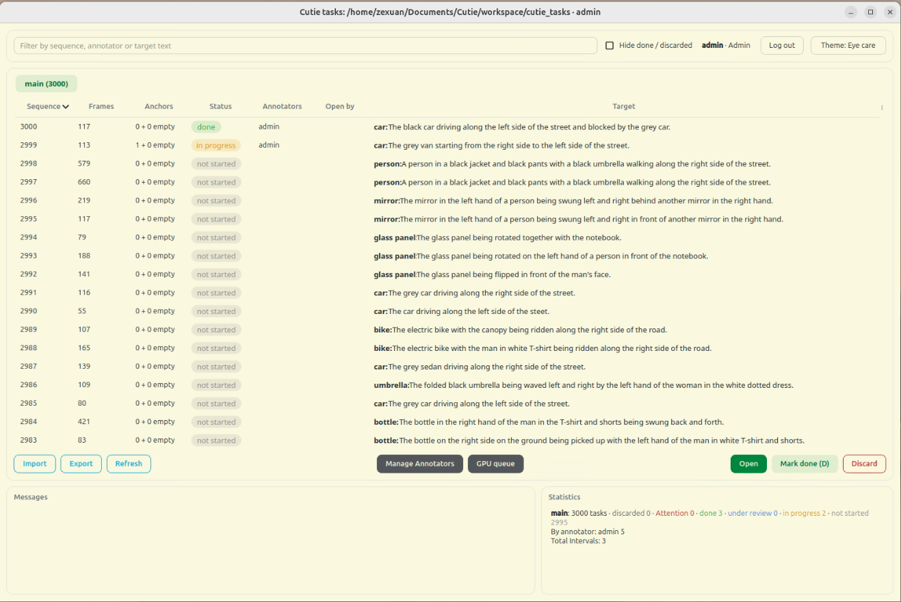
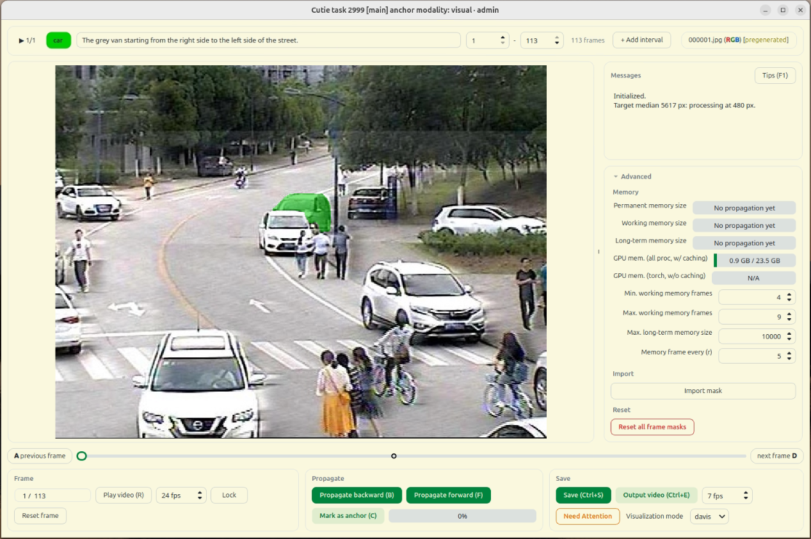

# CutiePlus

CutiePlus is a video object segmentation annotation tool built on [Cutie](https://github.com/hkchengrex/Cutie). It turns aligned RGB and thermal frame sequences into annotated datasets: select a target, refine its mask with clicks, propagate it through the sequence, review the results, and export labeled clips.

CutiePlus extends the original interactive demo with:

- **Dataset workflows:** browse subsets and sequences, track progress, and export completed clips with masks and metadata.
- **RGB–thermal annotation:** switch between aligned modalities while editing the same target mask.
- **Anchors and review:** preserve human corrections during propagation, mark target absence, and review clips before completion.
- **Shared GPU inference:** optionally support multiple annotators through individual remote desktops and a queued GPU worker.

Each task labels **one target**. See [changes from Cutie](docs/MODIFICATIONS.md) for the feature comparison and compatibility notes.

## Preview

| Task browser | Labeling window |
| --- | --- |
|  |  |
| Browse sequences and track annotation and review progress. | Refine target masks, propagate corrections, and select clip intervals. |

[Watch the annotation demo](docs/demo.mov)

## Quick start

The steps below set up a local desktop session. Run the commands in Bash. For remote annotators sharing a GPU, complete this setup on the host, then follow [multi-annotator deployment](docs/COOPERATION.md).

### 1. Check the requirements

- **Linux with a graphical desktop.** The committed environment targets Linux and Python 3.12.
- **An NVIDIA GPU compatible with the locked PyTorch CUDA 13 build**, with a driver from the 580 series or newer. See [NVIDIA's compatibility requirements](https://docs.nvidia.com/deploy/cuda-compatibility/minor-version-compatibility.html). The local application falls back to CPU when CUDA is unavailable; GPU inference is recommended.
- **Git, curl, a C/C++ compiler, and internet access.** RITM compiles a Cython extension when first loaded.

On an Ubuntu/Debian desktop, install the command-line tools and Qt runtime libraries:

```bash
sudo apt update
sudo apt install git curl build-essential libgl1 libegl1 libxcb-cursor0 libxkbcommon-x11-0
```

For missing display libraries or CUDA issues, see [setup troubleshooting](docs/SETUP.md#troubleshooting).

### 2. Install CutiePlus and its models

```bash
# Install uv if it is not already available.
curl -LsSf https://astral.sh/uv/install.sh | sh
source "$HOME/.local/bin/env"

git clone https://github.com/ShawnMenz/CutiePlus.git
cd CutiePlus
uv sync --locked
uv run python cutie/utils/download_models.py
```

`uv` installs Python 3.12 as needed and creates `.venv/`; environment activation is unnecessary when using `uv run`. Keep subsequent commands in the repository directory. The model downloader writes these two upstream checkpoints:

```text
weights/
├── cutie-base-mega.pth
└── coco_lvis_h18_itermask.pth
```

Check that the environment can import PyTorch and detect the GPU:

```bash
uv run python -c "import torch; print('PyTorch:', torch.__version__); print('CUDA available:', torch.cuda.is_available())"
```

For GPU use, the final line should report `CUDA available: True`. See [environment and model checks](docs/SETUP.md) for additional diagnostics and manual model downloads.

### 3. Prepare a dataset

Prepare your own frames under `workspace/cutie_tasks/`. Each subset becomes a browser tab, and each sequence becomes a task. Align the RGB and thermal images before import; the same mask applies to both. Use matching sequence names and zero-padded frame basenames:

```text
workspace/cutie_tasks/example/
├── categories.json
├── visual/sequence_01/
│   ├── 000001.jpg
│   └── 000002.jpg
└── thermal/sequence_01/
    ├── 000001.jpg
    └── 000002.jpg
```

Create `categories.json` with the target categories for the subset:

```json
["car", "person"]
```

Frames may be JPG, JPEG, PNG, or BMP. The **Import → Save** operation validates the subset and assigns colors to name-only categories, updating `categories.json`. A subset already at the location above stays there. **Importing a folder from elsewhere moves it into the workspace**; keep a separate copy if needed. See [input format](docs/WORKFLOW.md#tasks-and-their-files) for optional initial masks, target descriptions, and sequence metadata.

### 4. Launch and annotate

```bash
uv run python interactive_demo.py
```

1. Choose **Import**, check the subset, and select **Save**. Select a sequence in its tab and choose **Open**. The first open loads the models and may compile the click-model extension.
2. Choose the target category and enter a description. Left-click the target and right-click the background to refine its mask. Press **F** or **B** to propagate forward or backward. Inspect and correct the masks; press **T** to switch between RGB and thermal.
3. Set the clip's start and end frames if you want to export part of the sequence. Press **Ctrl+S** to submit it for review. After reviewing, select the sequence in the browser and choose **Mark done**.
4. Close the labeling window and choose **Export** in the browser. All completed intervals across subsets are assembled in `workspace/cutie_export/`.

Masks are saved as you work in `workspace/cutie_output/`; **Ctrl+S** also submits the task for review. Press **F1** for the in-app labeling guide. See the [workflow guide](docs/WORKFLOW.md) for anchors, intervals, review, custom task locations, and export behavior.

## Documentation

| Guide | Contents |
| --- | --- |
| [Setup and troubleshooting](docs/SETUP.md) | Environment checks, model downloads, and startup problems |
| [Annotation workflow](docs/WORKFLOW.md) | Input format, task states, intervals, outputs, and launch options |
| [Multi-annotator deployment](docs/COOPERATION.md) | Shared GPU installation, remote access, accounts, and recovery |
| [Changes from Cutie](docs/MODIFICATIONS.md) | Added capabilities and differences from upstream |
| [Changelog](docs/CHANGELOG.md) | Official CutiePlus releases, starting with v1.0.0 |
| [Architecture](docs/ARCHITECTURE.md) | Current GUI, inference backends, service, and storage design |
| [Training](docs/TRAINING.md) and [evaluation](docs/EVALUATION.md) | Optional Cutie model workflows and benchmark data |

The [in-app labeling guide](gui/TIPS.md), available with **F1**, is kept with the GUI resources so the application can load it directly.

## Attribution and license

CutiePlus builds on [Cutie](https://github.com/hkchengrex/Cutie), starting from upstream commit [`ec5cdd4`](https://github.com/hkchengrex/Cutie/commit/ec5cdd4cf16f75c73ad785a2f96fb97dbad4125a), and is developed independently from that baseline with its own releases. The Cutie model and original paper are the work of Ho Kei Cheng, Seoung Wug Oh, Brian Price, Joon-Young Lee, and Alexander Schwing. CutiePlus is not affiliated with or endorsed by the original authors; please report CutiePlus issues [here](https://github.com/ShawnMenz/CutiePlus/issues).

The repository is released under the [MIT License](LICENSE). The bundled [RITM click model](gui/ritm/LICENSE) has its own license. The interactive demo also builds on [IVS](https://github.com/seoungwugoh/ivs-demo), [MiVOS](https://github.com/hkchengrex/MiVOS), and [XMem](https://github.com/hkchengrex/XMem); thanks also to [XMem++](https://github.com/max810/XMem2). Model weights and datasets may have their own terms.

## Citation

If you use CutiePlus in your work, please cite both the software and the original Cutie paper. GitHub's **Cite this repository** feature provides a software citation from [CITATION.cff](CITATION.cff). You can also use the following BibTeX entries, updating the software entry with the version or commit you used:

```bibtex
@software{meng_cutieplus,
  author = {Meng, Zexuan},
  title = {{CutiePlus}},
  version = {1.0.0},
  year = {2026},
  url = {https://github.com/ShawnMenz/CutiePlus}
}
```

For the underlying Cutie model:

```bibtex
@inproceedings{cheng2024putting,
  title={Putting the Object Back into Video Object Segmentation},
  author={Cheng, Ho Kei and Oh, Seoung Wug and Price, Brian and Lee, Joon-Young and Schwing, Alexander},
  booktitle={CVPR},
  year={2024}
}
```
