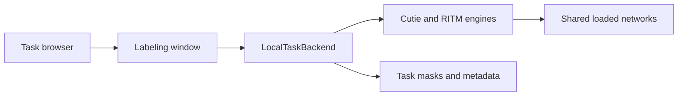
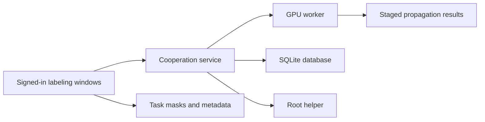

# Architecture

This guide describes the current CutiePlus implementation and the boundaries between the interface, inference, task files, and optional cooperation service. For installation and annotation instructions, see the [README](../README.md) and [workflow guide](WORKFLOW.md). For deployment, accounts, and recovery, see the [multi-annotator guide](COOPERATION.md).

## Components

| Component | Responsibility |
| --- | --- |
| `interactive_demo.py` | Parses launch arguments, selects local or service mode, and starts the Qt application. |
| `gui/task_browser.py` | Discovers subsets and tasks, opens a labeling window, manages review status, and starts dataset export. |
| `gui/main_controller.py` and `gui/gui.py` | Handle annotation controls, navigation, visualization, and interaction with a task backend. |
| `cutieplus/backends/` | Expose a common interface for click inference, propagation, frame edits, and task metadata. |
| `cutieplus/engine/` | Load models, manage RITM interactions, execute propagation one step at a time, and apply resolution and anchor policies. |
| `cutie/` | Provides the Cutie model, temporal memory, training, and benchmark evaluation inherited from upstream. |
| `cutieplus/cooperation/` | Implements application identities, authorization, management operations, audit records, and the shared GPU queue. |
| `cutieplus/gpu_worker/` | Executes inference commands for the cooperation service using one loaded pair of models. |
| `deploy/` | Installs the service, root helper, GPU worker, SSH configuration, and managed remote desktops. |

## Local execution

Without a cooperation client configuration, the application selects CUDA when available, then MPS, then CPU. The packaged environment targets Linux; device-selection code alone does not establish support for other operating systems.

The task browser loads Cutie and RITM on the first task open and reuses the networks across tasks. A labeling window receives a `LocalTaskBackend`, which owns its `InferenceCore`, RITM interaction, and active propagation state. Closing the window releases this task-specific state while the browser retains the networks for the next task.



Local propagation advances in the GUI process, one inference step at a time. The controller processes Qt events between steps. `FramePrefetcher` reads a bounded number of images ahead using threads, and `ResourceManager` queues mask writes on background save threads.

## Shared GPU execution

The installer creates `/etc/cutieplus/client.toml`. When this configuration is present, `interactive_demo.py` hides CUDA from the GUI process before importing Torch and starts `CooperationApp`. The application requires sign-in and uses `ServiceTaskBackend` for inference.



The service runs as the separate `cutieplus` system account from `/opt/cutieplus`. It checks application permissions and derives the request origin from Unix peer credentials and the peer process's systemd unit. A root helper performs a fixed set of account-access and desktop operations. The GPU worker and remote desktops run as the configured desktop account. Remote annotators have separate application identities but share that Linux account and its files; the [deployment guide](COOPERATION.md) describes this trust boundary.

The worker acquires an exclusive GPU lock before loading the networks. The service schedules one propagation at a time from its persistent queue. Click requests run between propagation steps, round-robin across users, with a bounded burst before propagation resumes. Model execution remains sequential in the worker.

Click results are returned to the labeling window, which commits the mask and anchor to the task files. Propagation instead uses a snapshot containing frame paths, anchor-mask bytes, start-frame probabilities, resolution, memory settings, and task revision. The worker stages output masks; the service records their hashes. The window applies the results only after validating the recorded hashes and the task revision, and does not replace anchors. A revision conflict holds the result for an explicit apply-or-discard decision.

If the service becomes unavailable, `OfflineTaskBackend` retains file-based editing and review operations while click inference and propagation are unavailable. There is no automatic fallback to local GPU inference on a service host.

## Inference state

### Propagation

`PropagationPlan` describes the frame order, direction, anchors, and interval bounds. `PropagationRuntime` owns the progression through permanent-anchor loading, the seed frame, and following frames; its `InferenceCore` owns Cutie's mutable temporal memory. Local mode keeps an `InferenceCore` for the window, while the shared worker constructs one for a propagation job.

In task mode, a propagation rebuilds permanent memory from selected mask anchors. Selection favors anchors nearest to the start frame, then loads them in chronological order. A fixed memory-read budget limits the selected anchors; it is an estimate and does not measure available VRAM. Anchors outside this selection still guide propagation when reached. Mask anchors are preserved, empty anchors stop the run, and a run started inside an interval stays within that interval. Images come from the selected display modality, with the resource manager's fallback when a paired frame is unavailable.

The task's resolution policy is evaluated when the window opens. It estimates target area from mask anchors or a sample of pregenerated masks. With the default 480-pixel shorter-edge setting, a target below the 1,500-pixel area threshold selects a 960-pixel internal size with upscaling enabled. This changes inference resolution, not the stored source images. See `cutieplus/engine/policies.py` for the formulas.

### Click interactions

`RitmEngine` separates the shared RITM network from each interaction's image, starting mask, ordered clicks, predictor state, and undo history. Local mode keeps one open interaction. The worker can track several interactions, keeping the active interaction on the inference device and inactive predictor snapshots on CPU. When a snapshot is evicted, accepted clicks reconstruct the interaction on demand.

The click controller uses NoBRS with no click limit. Display color tables are created on CPU and copied to the image's device when needed; importing visualization code does not initialize CUDA.

## Task data and persistence

The task backend interface carries arrays, tensors, and plain values, with no Qt objects. `TaskDataBackend` implements the file-based operations shared by local and service backends: frame commits, anchors, intervals, category and description edits, review submission, and reset operations. Inference reaches these operations through the selected backend.

Task inputs live under `workspace/cutie_tasks/` by default. Frames are read in place during annotation; the import operation can move a subset and fill missing category colors. Work is stored separately as `masks/` and `metadata.json` under `workspace/cutie_output/<subset>/<sequence>/`. See the [workflow guide](WORKFLOW.md#tasks-and-their-files) for the complete format and custom-path behavior.

Masks are written to temporary files and renamed into place. Save-worker exceptions are collected and reported instead of terminating a worker and leaving its queue blocked. Metadata writes read the existing JSON and replace the relevant sections under a process lock, then replace the file atomically. These operations avoid partially written individual files; they do not form a transaction across masks and metadata.

`TaskLock` uses an exclusive `flock` in `~/.cache/cutieplus/task-locks/` to prevent concurrent windows or export from holding the same task under the shared account. The kernel releases the lock when its process exits. Task revisions increase with mask or anchor changes and are also used to guard shared-worker result application.

`EditHistory` keeps up to 100 frame edits, including mask bytes and anchor state. RITM handles undo within an active click interaction before the controller falls back to frame-edit history. Propagation is not undoable.

Dataset export is separate from ongoing annotation: `gui/dataset_export.py` plans clips from completed tasks, locks the source tasks, builds a temporary export, and replaces the previous export after completion. The [workflow guide](WORKFLOW.md) documents review states, masks, clip metadata, and demo-video output.

## Configuration and checks

The GUI and worker compose [`gui_config.yaml`](../cutie/config/gui_config.yaml) for model, memory, and I/O defaults. The inference-policy functions are in `cutieplus/engine/policies.py`. Root-owned service and client TOML files configure the optional deployment, while application administrators can change bounded runtime settings through the GUI.

Relevant tests include `tests/test_engine.py` for inference behavior, `tests/test_resource_manager.py` for saving, `tests/test_task_state.py` for task metadata, and the `tests/test_cooperation_*.py` modules for authorization, lifecycle, and shared execution. Tests marked `models` or `gpu` require the corresponding weights or device; the default pytest configuration excludes `gpu` tests.

Run the CPU suite from the repository directory:

```bash
uv run pytest
```

For the GPU-marked tests, enable CUDA in the test fixtures and select that marker explicitly:

```bash
CUTIEPLUS_TEST_GPU=1 uv run pytest -m gpu
```

The fixtures use offscreen Qt and temporary task and lock directories. If an inherited `PYTHONPATH` or globally discovered pytest plugin interferes with collection, use an isolated invocation:

```bash
env -u PYTHONPATH PYTEST_DISABLE_PLUGIN_AUTOLOAD=1 uv run pytest
```
